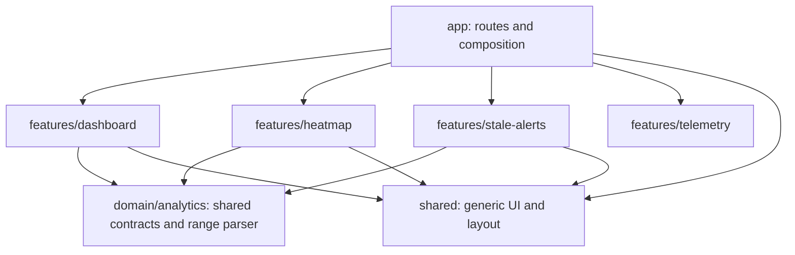

# Frontend boundary decisions

## Scope and status vocabulary

This review continues the Issue #8 frontend scaffold. The working baseline was
`e6db95fad72da831aecd633ca96e2177fd511868`, with local uncommitted work that
placed all dashboard types, fixture data, and aggregation in a new
`features/analytics` module. The changes below narrow that module boundary.

Status words are used precisely:

- **Implemented:** present in the committed code.
- **Verified:** directly exercised by a listed local check.
- **Planned:** a next task only; no code is claimed.
- **Deferred:** intentionally outside this scaffold task.

## Dependency direction

`domain/analytics` contains only plain TypeScript contracts and the range parser;
it imports no React, fixture, UI, or feature module. Feature modules depend on
domain contracts and generic shared components. `shared` does not import
features. Route modules remain Server Components and compose data adapters,
feature views, and route parameters.

The root layout creates the telemetry gauge and passes it to the client shell as
a `ReactNode` slot. This keeps telemetry ownership in the composition root and
keeps `AppShell` and `Header` generic. Next production build and the AppShell
component test verified this composition.

## Decisions

### FE-FOLLOWUP-01 — Keep only cross-feature contracts in the analytics domain

- **Context:** Dashboard, Heatmap, and Stale Alerts need overlapping range and
  collaboration data contracts. The WIP `features/analytics` also held the
  Dashboard fixture and Dashboard aggregation.
- **Options considered:** Keep a broad Analytics feature as a shared module;
  import Dashboard types from other features; or add a pure domain contract
  module and keep feature behavior with its owner.
- **Decision:** Put `DashboardRange`, `ActivityDay`, and `CollaborationAlert`
  plus `parseDashboardRange` in the pure `domain/analytics` module.
- **Rationale:** These contracts have multiple consumers. The parser is used by
  the Dashboard, Heatmap, and Stale Alerts routes. A UI-free contract module
  preserves dependency direction without turning every analytics concern into
  a generic abstraction.
- **Trade-offs:** The shared `ActivityDay` contains only fields common to
  Dashboard and Heatmap; Dashboard-specific review wait values are an extension
  in its own feature.
- **Status:** Implemented; type and range behavior verified by the domain test
  and TypeScript check.
- **Code evidence:** [domain contracts](../../../frontend/src/domain/analytics/types.ts),
  [range parser](../../../frontend/src/domain/analytics/range.ts),
  [domain tests](../../../frontend/src/__tests__/analytics-domain.test.ts).

### FE-FOLLOWUP-02 — Keep Dashboard data and aggregation in Dashboard

- **Context:** `DashboardData`, `DashboardMetric`, fixture loading, median
  calculation, and selected-period aggregation are specific to the Dashboard.
- **Options considered:** Place them in the shared domain module; expose them
  from a generic analytics feature; or keep them in `features/dashboard`.
- **Decision:** Keep the data and model in Dashboard. `DashboardActivityDay`
  extends the shared activity contract with `reviewWaitHours`. Heatmap has its
  own small activity projection in `features/heatmap/model.ts`.
- **Rationale:** This avoids cross-feature imports and keeps Dashboard fixture
  adaptation and metrics with their owner. Heatmap gets only its own date slice
  and label behavior.
- **Trade-offs:** Dashboard and Heatmap each select their own period view; this
  small feature-specific projection is clearer than a broad shared analytics
  model.
- **Status:** Implemented; Dashboard model, Heatmap selection, and route behavior
  verified offline.
- **Code evidence:** [Dashboard types](../../../frontend/src/features/dashboard/types.ts),
  [Dashboard model](../../../frontend/src/features/dashboard/model.ts),
  [fixture adapter](../../../frontend/src/features/dashboard/data.ts),
  [Heatmap model](../../../frontend/src/features/heatmap/model.ts),
  [Heatmap tests](../../../frontend/src/__tests__/heatmap-model.test.ts).

### FE-FOLLOWUP-03 — Compose telemetry as a slot in the root layout

- **Context:** The shared shell displayed GitHub rate-limit telemetry, which
  made `shared` import the telemetry feature directly.
- **Options considered:** Keep the feature import in `shared`; move the gauge
  into a second shell wrapper; or create the gauge in the Server Component root
  layout and pass its rendered node through the shell.
- **Decision:** `app/layout.tsx` creates `RateLimitGauge` with the fixture quota
  and passes it as `quotaSlot` to `AppShell` and `Header`.
- **Rationale:** The composition root may assemble features; a generic shell
  should not know the telemetry contract. A server-created React node can be
  passed through the client boundary as a slot.
- **Trade-offs:** The root layout owns this composition. The slot API remains
  generic and optional for shell tests and alternate callers.
- **Status:** Implemented and verified by the AppShell slot test and successful
  Next.js production build.
- **Code evidence:** [root layout](../../../frontend/src/app/layout.tsx),
  [AppShell](../../../frontend/src/shared/components/layout/AppShell.tsx),
  [Header](../../../frontend/src/shared/components/layout/Header.tsx),
  [slot test](../../../frontend/src/__tests__/AppShell.test.tsx).

### FE-FOLLOWUP-04 — Keep route modules as server-side composition

- **Context:** Route pages must retain existing URLs and 3/7-day behavior while
  the shell and feature boundaries are refined.
- **Options considered:** Move interactions into route modules; add client
  state to the shell; or keep route pages server-rendered and delegate
  presentation/state to the feature views.
- **Decision:** Keep routes as Server Components. They parse supported range
  parameters, select fixture-backed data, and compose feature views. The mobile
  drawer state remains in `AppShell`.
- **Rationale:** This retains the current routes and keeps state at the client
  components that need it.
- **Trade-offs:** Browser visual QA is still required for viewport-specific
  layout; the local automated checks do not establish responsive appearance.
- **Status:** Implemented; route responses and component tests verified. Visual
  viewport QA was not verified in this environment.
- **Code evidence:** [dashboard route](../../../frontend/src/app/page.tsx),
  [heatmap route](../../../frontend/src/app/heatmap/page.tsx),
  [stale alerts route](../../../frontend/src/app/stale-alerts/page.tsx),
  [route tests](../../../frontend/src/__tests__/pages.test.tsx),
  [navigation tests](../../../frontend/src/__tests__/DashboardView.test.tsx).

## Data and privacy boundary clarification

Dashboard and detail views still read the offline fixture through
[`features/dashboard/data.ts`](../../../frontend/src/features/dashboard/data.ts).
[`shared/config/api.ts`](../../../frontend/src/shared/config/api.ts) and
[`NEXT_PUBLIC_API_URL`](../../../frontend/src/shared/config/env.ts) construct
configuration only; the frontend does not call those URLs. The backend currently
has S1 authentication, repository sync, webhook ingestion, health/readiness, and
tenant audit routes. Its route modules do not expose metrics or findings
endpoints, so the future analytics contract must be agreed with backend owners
before integration is designed.

No backend call, package installation, Next major upgrade, or new analytics
product behavior was added. The UI remains fixture-backed and within the
metadata-only privacy boundary described by the repository rules and
[Privacy statement](../../../PRIVACY.md).
